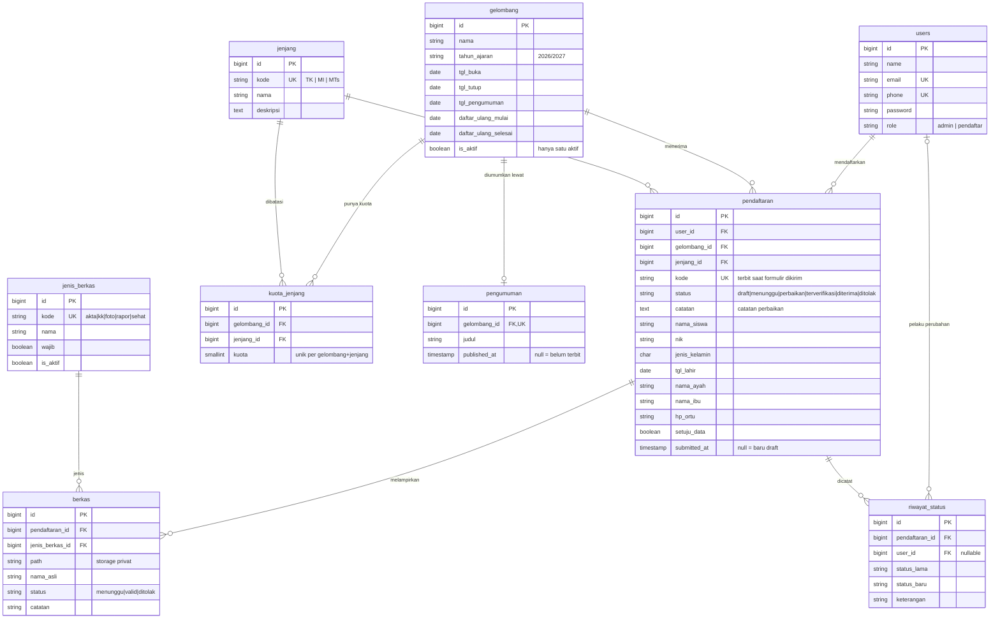
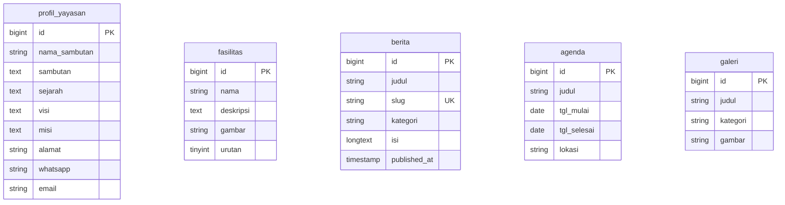
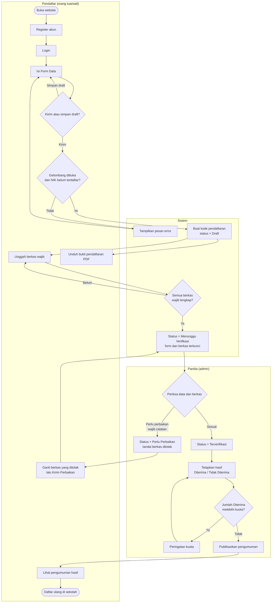
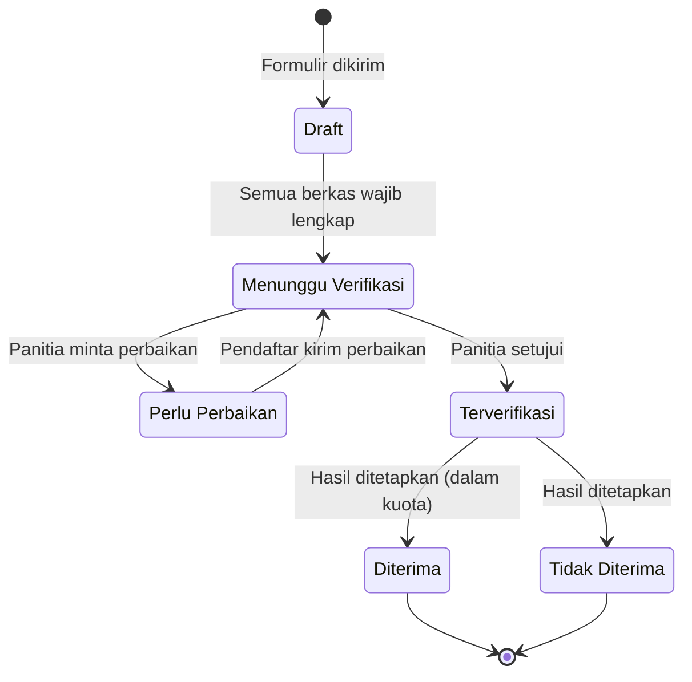
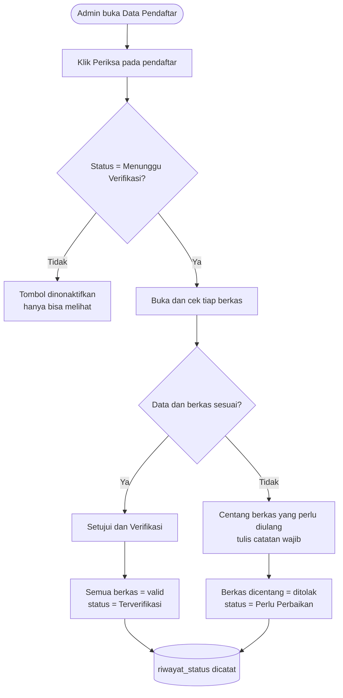
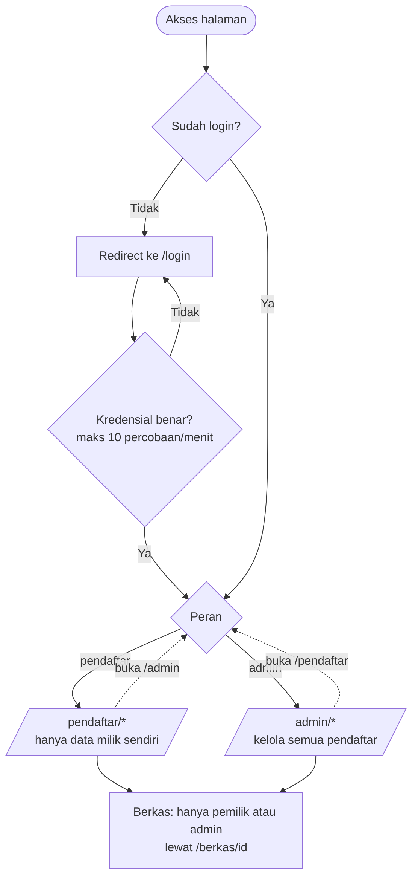

# ERD & Flowchart — Sistem PPDB Yayasan Amanah

Database: `ppdb_amanah` (MariaDB/XAMPP). Diagram ditulis dengan [Mermaid](https://mermaid.js.org/), yang tampil langsung di GitHub dan VS Code (ekstensi Markdown Preview Mermaid). Versi yang bisa dibuka di browser: <http://localhost:8000/docs/erd-flowchart.html>.

## 1. ERD

Sumber: migrasi di `database/migrations/` (`2026_10_05_000001_create_ppdb_tables.php`, `2026_10_05_000002_create_konten_tables.php`, dan tabel `users`). Terdapat 10 foreign key; semuanya tergambar di bawah.

Tabel konten company profile (belum berelasi dengan tabel PPDB; dikelola panitia pada Fase 3–4):

Catatan desain:

- `pendaftaran.kode` bernilai `NULL` selama formulir masih draft; kode acak terbit saat formulir dikirim (`submitted_at` terisi).
- `kuota_jenjang` memisahkan kuota dari `jenjang` karena kuota berbeda tiap gelombang.
- Hasil seleksi per pendaftar disimpan di `pendaftaran.status`. Tabel `pengumuman` hanya menentukan **kapan** hasil boleh dilihat (`published_at`).
- `riwayat_status` adalah jejak audit: status lama/baru, pelaku, waktu, dan keterangan.
- Lima tabel konten (`profil_yayasan`, `fasilitas`, `berita`, `agenda`, `galeri`) belum dipakai halaman publik; disiapkan untuk Fase 3–4 PRD.
- Tabel bawaan Laravel (`migrations`, `failed_jobs`, `password_reset_tokens`, `personal_access_tokens`) tidak digambar.

## 2. Flowchart alur pendaftaran (end-to-end)

## 3. Diagram status pendaftaran

Setiap perpindahan dicatat di `riwayat_status`. Hasil `Diterima`/`Tidak Diterima` baru terlihat pendaftar setelah pengumuman dipublikasikan.

## 4. Flowchart verifikasi oleh panitia

## 5. Flowchart hak akses (login dan peran)

