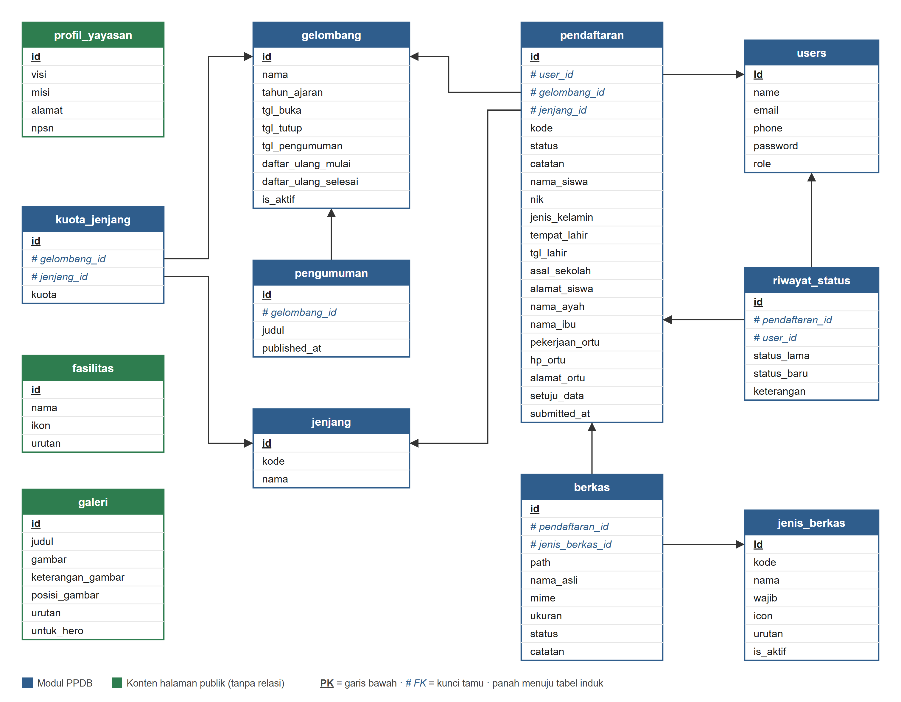

# Logical Record Structure (LRS) — PPDB SMP Islam Sirojul Athfal

Database: `ppdb_amanah` (MySQL/XAMPP). Gambar hanya memuat tabel dan atribut yang **dipakai kode aplikasi** (controller, model, view, seeder), bukan seluruh isi migrasi.
Gambar dibuat ulang dengan `node docs/build-lrs.cjs` (butuh Google Chrome untuk membuat PNG).

**Notasi:** kotak = tabel/record · <u>**atribut**</u> bergaris bawah = Primary Key · `#atribut` = Foreign Key · panah = dari tabel pemegang FK (anak) ke tabel induk. `created_at`/`updated_at` tidak digambar.



Biru = modul PPDB (9 tabel). Hijau = konten halaman publik (3 tabel, berdiri sendiri, tanpa relasi).

## Notasi teks

PK digarisbawahi (`__id__`), FK diawali `#`.

```
users           (__id__, name, email, phone, password, role)
gelombang       (__id__, nama, tahun_ajaran, tgl_buka, tgl_tutup, tgl_pengumuman,
                 daftar_ulang_mulai, daftar_ulang_selesai, is_aktif)
jenjang         (__id__, kode, nama)
kuota_jenjang   (__id__, #gelombang_id, #jenjang_id, kuota)
jenis_berkas    (__id__, kode, nama, wajib, icon, urutan, is_aktif)
pendaftaran     (__id__, #user_id, #gelombang_id, #jenjang_id, kode, status, catatan,
                 nama_siswa, nik, jenis_kelamin, tempat_lahir, tgl_lahir, asal_sekolah, alamat_siswa,
                 nama_ayah, nama_ibu, pekerjaan_ortu, hp_ortu, alamat_ortu, setuju_data, submitted_at)
berkas          (__id__, #pendaftaran_id, #jenis_berkas_id, path, nama_asli, mime, ukuran, status, catatan)
riwayat_status  (__id__, #pendaftaran_id, #user_id, status_lama, status_baru, keterangan)
pengumuman      (__id__, #gelombang_id, judul, published_at)

profil_yayasan  (__id__, visi, misi, alamat, npsn)
fasilitas       (__id__, nama, ikon, urutan)
galeri          (__id__, judul, gambar, keterangan_gambar, posisi_gambar, urutan, untuk_hero)
```

## Relasi (10 foreign key)

| Tabel anak | FK | Tabel induk | Relasi | Catatan |
|---|---|---|---|---|
| `pendaftaran` | `user_id` | `users` | 1 : N | satu akun bisa mendaftarkan beberapa anak |
| `pendaftaran` | `gelombang_id` | `gelombang` | 1 : N | |
| `pendaftaran` | `jenjang_id` | `jenjang` | 1 : N | |
| `kuota_jenjang` | `gelombang_id` | `gelombang` | 1 : N | UNIQUE (`gelombang_id`, `jenjang_id`) |
| `kuota_jenjang` | `jenjang_id` | `jenjang` | 1 : N | tabel penghubung `gelombang` – `jenjang` |
| `pengumuman` | `gelombang_id` | `gelombang` | 1 : 1 | `gelombang_id` UNIQUE; hasil tampil bila `published_at` terisi |
| `berkas` | `pendaftaran_id` | `pendaftaran` | 1 : N | UNIQUE (`pendaftaran_id`, `jenis_berkas_id`) |
| `berkas` | `jenis_berkas_id` | `jenis_berkas` | 1 : N | |
| `riwayat_status` | `pendaftaran_id` | `pendaftaran` | 1 : N | |
| `riwayat_status` | `user_id` | `users` | 1 : N (opsional) | pelaku perubahan; kosong bila aksi sistem |

## Yang sengaja tidak digambar

Semuanya masih ada di database, tetapi tidak dibaca atau ditulis oleh kode aplikasi.

- **Kolom `users`:** `email_verified_at` (fitur verifikasi email tidak dipakai), `remember_token` (kolom bawaan Laravel untuk "Ingat saya").
- **Tabel `berita` dan `agenda`:** tidak ada halaman, controller, atau seeder yang memakainya.
- **Kolom `profil_yayasan`:** `nama_sambutan`, `jabatan_sambutan`, `sambutan`, `sejarah`, `telepon`, `whatsapp`, `email`. Halaman publik hanya memakai `visi`, `misi`, `alamat`, `npsn`.
- **Kolom lain:** `jenjang.deskripsi`, `pengumuman.isi`, `fasilitas.deskripsi`, `fasilitas.gambar`, `galeri.kategori`.
- **Tabel framework Laravel:** `password_reset_tokens`, `failed_jobs`, `personal_access_tokens`, `migrations`.

Dokumen ERD lama (`docs/erd-data.cjs`, `docs/Jawaban ERD Pertemuan 9`, `prd.md`) masih memakai `tahun_ajaran` dan jenjang TK/MI/MTs, jadi tidak sama dengan skema ini.
